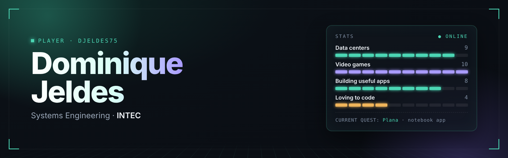

  
  

 

**About** · Systems Engineering student at INTEC. Interested in data centers and video games.
I build an app when I need one, and I keep it only if I actually use it.

 

### Featured

<table>
<tr>
<td width="55%">

</td>
<td>

**[Plana](https://github.com/Djeldes75/Plana)** 
Notebook templates for Samsung Notes, sized to the real screen of each Galaxy Tab.

Vector PDF · works offline · installable · English, Español, Lietuvių

</td>
</tr>
</table>

### Coursework

| | |
|---|---|
| [software-dev-lab-3](https://github.com/Djeldes75/software-dev-lab-3) | ASP.NET Core, NServiceBus, TCP sockets, web services, SSRS |
| [dsa-2](https://github.com/Djeldes75/dsa-2) | Graphs, backtracking, Minimax; maze game in Python |
| [dsa-1](https://github.com/Djeldes75/dsa-1) | Stacks, queues, trees, hash tables in C++ |
| [software-dev-2](https://github.com/Djeldes75/software-dev-2) | Sales and purchasing system on SQL Server |
| [software-dev-1](https://github.com/Djeldes75/software-dev-1) | Inventory and library systems in C# |

### Tools

