  <a href="https://www.twitch.tv/qdothy">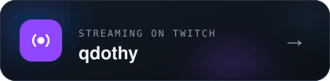</a>
  <a href="https://www.youtube.com/@qDothy">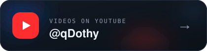</a>
  <a href="https://www.linkedin.com/in/dominiquejeldes">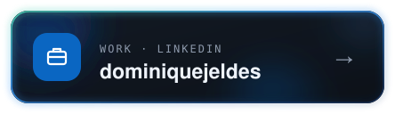</a>

#### Now


#### Building

<a href="https://github.com/Djeldes75/Plana">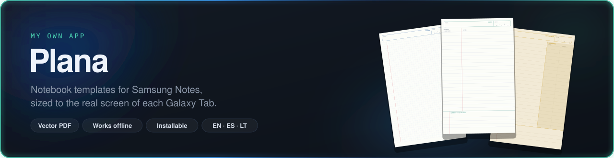</a>

#### Coursework

  <a href="https://github.com/Djeldes75/software-dev-lab-3">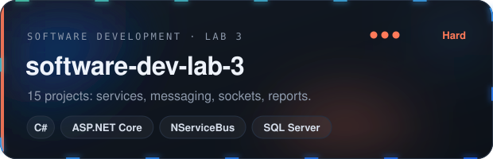</a>
  <a href="https://github.com/Djeldes75/dsa-2">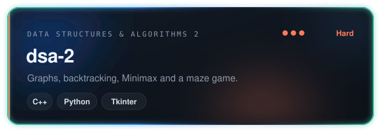</a>
  <a href="https://github.com/Djeldes75/software-dev-2">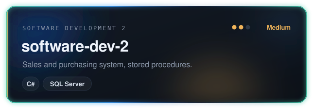</a>
  <a href="https://github.com/Djeldes75/dsa-1">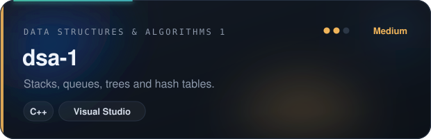</a>
  <a href="https://github.com/Djeldes75/software-dev-1">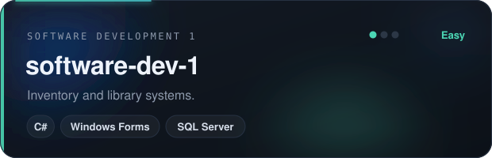</a>
  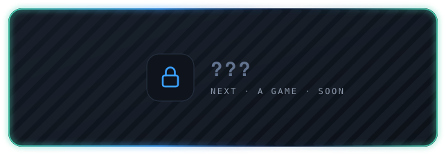

#### Toolbox


<!-- Para actualizar tu carrera: edita career.json y cambia "progress". La barra se redibuja sola. -->
