  
  
  

#### Now

#### Building

#### Coursework

<a href="https://github.com/Djeldes75/software-dev-lab-3">software-dev-lab-3</a> ·
<a href="https://github.com/Djeldes75/dsa-2">dsa-2</a> ·
<a href="https://github.com/Djeldes75/software-dev-2">software-dev-2</a> ·
<a href="https://github.com/Djeldes75/dsa-1">dsa-1</a> ·
<a href="https://github.com/Djeldes75/software-dev-1">software-dev-1</a>

#### Toolbox

<!-- Para actualizar tu carrera: edita career.json y cambia "progress". La barra se redibuja sola. -->
